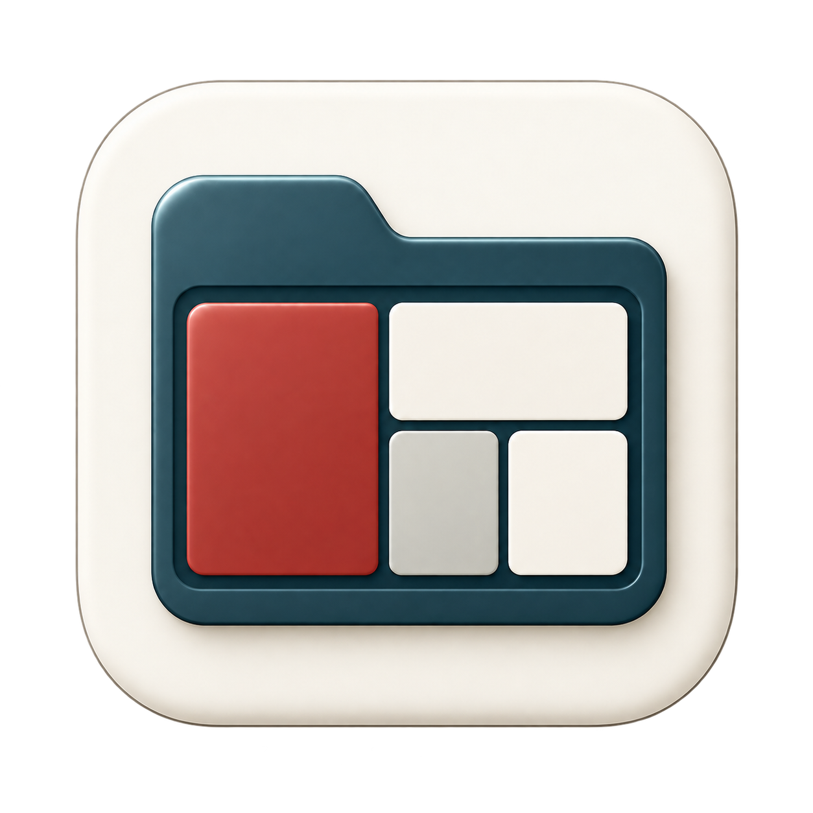
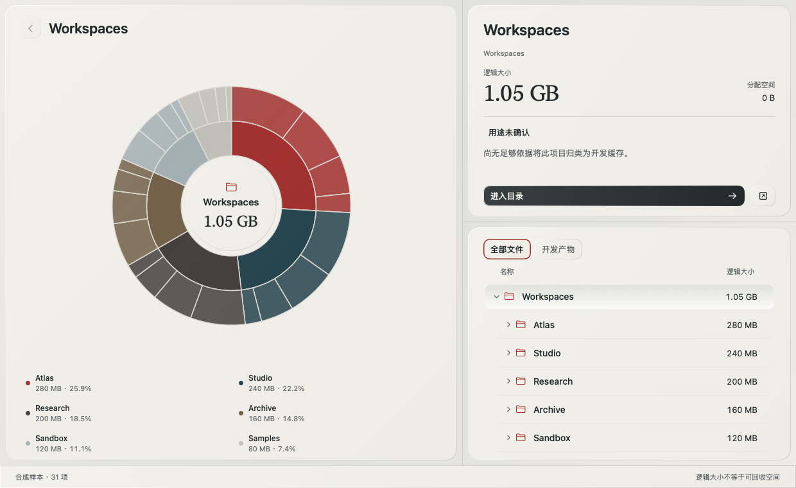
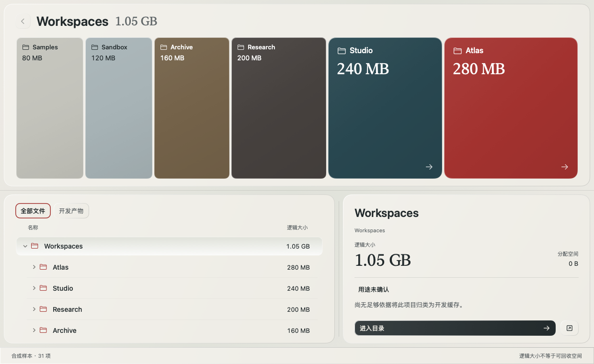

<div align="center">
  
  <h1>FileSweep</h1>
  <p><strong>看清 Mac 的空间占用。</strong></p>
  <p>原生 macOS 磁盘空间可视化工具。浏览目录、定位大文件、了解开发产物，只读扫描，本地分析。</p>
  <p>
    <a href="https://github.com/SaraiNoQ/files-sweep/releases/latest"></a>
    
    
  </p>
  <p>
    <a href="https://github.com/SaraiNoQ/files-sweep/releases/latest">下载应用</a> ·
    <a href="#开始使用">开始使用</a> ·
    <a href="#从源码构建">从源码构建</a> ·
    <a href="https://github.com/SaraiNoQ/files-sweep/issues">反馈问题</a>
  </p>
</div>



<p align="center"><sub>v0.4.0 界面预览，使用合成样本展示。</sub></p>

<details>
<summary>查看矩形图视图</summary>



</details>

## 功能

- **两种空间视图**：用多层环图查看目录层级，或切换 Treemap 浏览当前目录；点击项目联动详情与目录树，小项可进入分组继续查看。
- **搜索与定位**：按文件名搜索，查看逻辑大小、分配空间和相对路径，并在 Finder 中定位项目。
- **开发产物识别**：识别 Python、Node、Rust、Go、Java 的开发产物，展示识别依据、保护原因与待核验事项。
- **目录变化更新**：监听当前窗口选中的根目录，合并变化后更新相关目录；支持暂停和恢复。
- **本地扫描记录**：将结果保存为 `.filesweep` 文件，稍后打开查看；历史记录不会自动重扫。
- **原生交互**：SwiftUI 与 AppKit 构建，支持可拖动分区、键盘浏览和元数据预览。

## 下载与安装

当前发布版为 **[v0.4.0](https://github.com/SaraiNoQ/files-sweep/releases/tag/v0.4.0)**，需要 **macOS 13+ 和 Apple Silicon（arm64）**，不支持 Intel Mac。

| 下载 | 用途 |
| --- | --- |
| [DMG 安装镜像](https://github.com/SaraiNoQ/files-sweep/releases/download/v0.4.0/FileSweep-0.4.0-macos-arm64.dmg) | 推荐：打开后将 `FileSweep.app` 拖入 `Applications` |
| [ZIP 压缩包](https://github.com/SaraiNoQ/files-sweep/releases/download/v0.4.0/FileSweep-0.4.0-arm64.zip) | 解压后将应用放入“应用程序” |
| [SHA-256 校验文件](https://github.com/SaraiNoQ/files-sweep/releases/download/v0.4.0/SHA256SUMS.txt) | 核对下载文件是否完整 |

更新前请先退出旧版 FileSweep，再替换“应用程序”中的副本。

> **首次打开**：当前发布包使用 ad-hoc 临时签名，尚未经过 Developer ID 签名或 Apple 公证，macOS 可能阻止首次打开。请先核对下载来源，再参考 [Apple 官方说明](https://support.apple.com/zh-cn/guide/mac-help/mh40616/mac)。

## 开始使用

1. 打开 FileSweep，选择一个要分析的文件夹。扫描只覆盖你选中的范围。
2. 在环图或矩形图中查看空间分布，结合目录树、搜索和右侧详情核对项目；需要时在 Finder 中定位。
3. 在“开发产物”中按语言和名称筛选，查看每个项目的识别依据与保护状态。
4. 通过工具栏“扫描记录”保存结果，或打开之前保存的 `.filesweep` 文件。

| 快捷键 | 操作 |
| --- | --- |
| `⌘O` | 选择文件夹并扫描 |
| `⌘S` | 保存当前扫描记录 |
| `⇧⌘O` | 打开扫描记录 |
| `↑` `↓` `←` `→` | 环图获得焦点后，切换扇区 |
| `Enter` / `Backspace` | 在环图中进入当前项目 / 返回上一级 |
| 按住 `Space` / `Esc` | 在环图中预览元数据 / 关闭预览 |

环图中的目录可双击进入；文件双击只显示元数据。自动更新可在工具栏暂停或恢复；根目录移动或被替换时会停止，需重新选择。

## 隐私与数据边界

以下说明对应已发布的 **v0.4.0**：

- **只读元数据**：不读取被扫描文件的正文，不跟随符号链接，不执行被扫描项目中的脚本，不自动扩大扫描范围。
- **不提供清理操作**：没有删除、移入废纸篓或提权功能；开发产物的“待核验”状态不表示可以安全删除。
- **本地处理**：扫描与规则分析在本机完成，不上传扫描数据；v0.4.0 尚未接入在线 AI 解释。
- **记录由你保存**：`.filesweep` 不含文件正文，但包含路径和文件名等元数据，且未加密；分享前请自行检查。打开记录只查看历史状态，主动重扫后才获取当前结果。
- **统计有边界**：读取失败、取消和跨卷跳过会标记结果不完整。逻辑大小、分配空间和实际可回收空间并不相同；矩形图为保证可读性设有面积下限，不能按面积直接换算字节数。

更详细的规则见 [开发产物识别](docs/developer-rules.md)、[扫描记录格式](docs/scan-archives.md) 和 [性能与已知边界](docs/performance.md)。

## 从源码构建

需要 Apple Silicon Mac、Swift 6，以及 Xcode 或 Command Line Tools。

```sh
git clone https://github.com/SaraiNoQ/files-sweep.git
cd files-sweep
sh scripts/build-app.sh
open dist/FileSweep.app
```

生成 DMG、ZIP 与 SHA-256 校验文件：

```sh
sh scripts/package-release.sh
```

产物位于 `dist/`。脚本会验证镜像、只读挂载核对内含应用并检查签名完整性；默认使用 ad-hoc 签名，不代表通过 Apple 公证。开发构建采用独立签名后原子替换，保留的 `dist/.previous-build-*.app` 可能仍被旧进程使用，请勿在旧进程运行时改写。

<details>
<summary>开发检查与性能基准</summary>

核心检查使用 Debug 运行，不能添加 `-c release`，否则断言会被优化掉：

```sh
CLANG_MODULE_CACHE_PATH="$PWD/.build/clang-cache" \
SWIFTPM_MODULECACHE_OVERRIDE="$PWD/.build/swift-cache" \
swift run --disable-sandbox filesweep-checks

sh scripts/check-sunburst-input.sh
sh scripts/check-outline.sh
python3 scripts/check-publish.py
```

文件事件检查需要连接 macOS FSEvents 服务；受限环境可能无法运行。检查使用独立生成的样本，不对个人文件做破坏性测试。

扫描与界面重绘基准：

```sh
CLANG_MODULE_CACHE_PATH="$PWD/.build/clang-cache" \
SWIFTPM_MODULECACHE_OVERRIDE="$PWD/.build/swift-cache" \
swift build --disable-sandbox -c release --product filesweep-bench

python3 scripts/benchmark.py --files 100000
python3 scripts/benchmark.py --files 1000000
sh scripts/benchmark-ui.sh after
```

扫描样本创建在 `.bench-fixture/`，结果写入 `docs/benchmark-*.json`；UI 基准写入 `design/qa/ui-performance/`。UI 测量包含离屏位图读回成本，不等同于实际屏幕帧率。

</details>

## 文档

- [版本说明](docs/releases/v0.4.0.md)
- [性能与已知边界](docs/performance.md)
- [开发产物规则与保护边界](docs/developer-rules.md)
- [自动增量扫描](docs/incremental-scanning.md)
- [扫描记录格式与限制](docs/scan-archives.md)
- [AI 数据边界](docs/ai-explanation.md)
- [设计约定](DESIGN.md)

## 反馈与贡献

欢迎通过 [Issues](https://github.com/SaraiNoQ/files-sweep/issues) 报告问题或提出建议。报告问题时请附上 macOS 版本、Mac 型号和复现步骤；涉及文件路径、名称或扫描记录时，先移除敏感信息。

提交改动前请阅读 [AGENTS.md](AGENTS.md)，并为行为变化补充对应检查。欢迎围绕扫描正确性、性能和原生交互提交改进。
